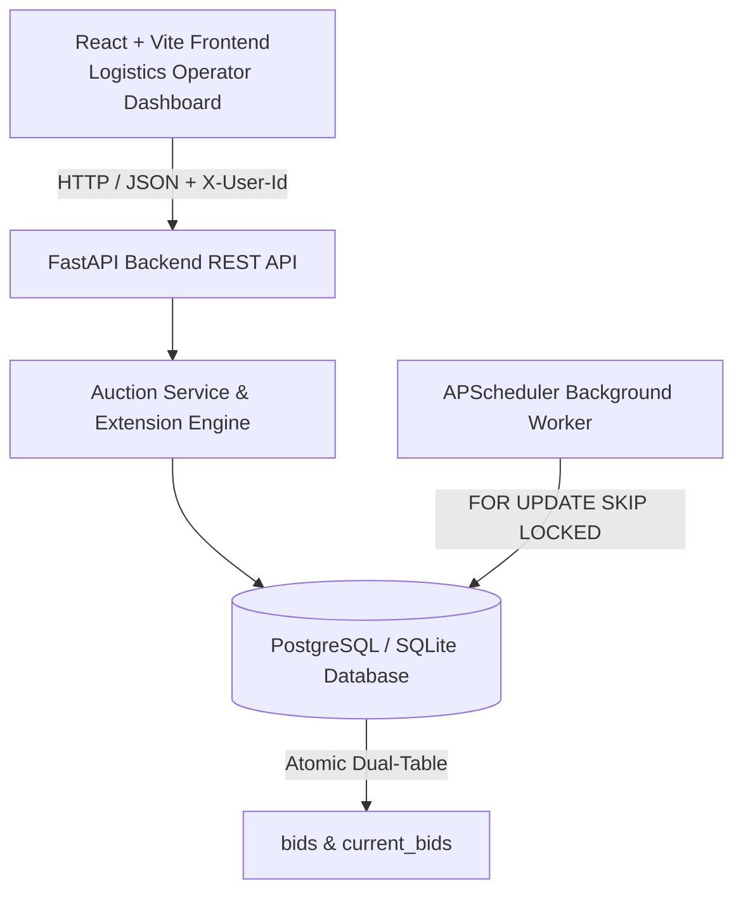

# British Auction Reverse Bidding System for Freight RFQ

A high-performance reverse auction system with dynamic extension dynamics (British Auction mechanism) for freight procurement. Features automatic closing window extensions, hard forced close caps, atomic dual-table bid management, and real-time live tickers.

Built with **FastAPI**, **SQLAlchemy 2.0**, **PostgreSQL / SQLite**, and a **React + Vite** frontend.

---

## 🚀 Key Features

1. **British Auction Dynamic Extension Engine**:
   - Configurable trigger windows ($X$ minutes) and extension durations ($Y$ minutes).
   - Three distinct triggers:
     - `BID_RECEIVED`: Any valid bid inside the closing window extends the auction.
     - `ANY_RANK_CHANGE`: Any bid causing a change in the full supplier ranking sequence triggers an extension.
     - `L1_RANK_CHANGE`: Only bids taking over the lowest (L1) price trigger an extension.
   - Strict half-open window evaluation $[C - X, C)$.
   - Hard upper cap ($F$, `forced_close_time`) ensuring auctions never loop indefinitely.
   - Atomic state transitions: skips extensions cleanly with `EXTENSION_SKIPPED_FORCED_CAP` when the cap is reached.

2. **Atomic Bid Processing & Strict Price Discipline**:
   - `SELECT ... FOR UPDATE` row-level locks prevent race conditions under concurrent submissions.
   - Dual-table storage pattern: complete chronological audit in `bids`, latest active standing in `current_bids`.
   - Strict strictly-decreasing price rule per supplier: revisions must be strictly lower than the supplier's previous active bid.

3. **Immutable Closure Semantics & Background Polling**:
   - APScheduler polls every 10 seconds using `FOR UPDATE SKIP LOCKED` for zero-overhead multi-worker execution.
   - Immutable terminal statuses (`CLOSED` vs `FORCE_CLOSED`).
   - Shared closure routine ensures idempotency across both background jobs and lazy REST requests.

4. **Logistics Operator Dashboard**:
   - Dark-mode default with high-density data tables and real-time color tokens.
   - Live millisecond countdown ticker with urgency color shifts (Urgent / Critical).
   - Instant bid price calculator previewing total landed freight (Base + BAF + THC).
   - Demo identity switcher for seamless role transitions (Buyer vs Carrier).

---

## 🛠️ Architecture & Tech Stack



- **Backend**: Python 3.13, FastAPI, SQLAlchemy 2.0, APScheduler, Pydantic v2.
- **Frontend**: React 18, Vite 6, Vanilla CSS (Design Tokens, high density).
- **Database**: PostgreSQL 16 (production container) / SQLite with StaticPool (lightweight local dev/tests).
- **Testing**: Pytest with full fixture coverage and concurrency tests.

---

## 🏁 Quickstart

### Prerequisites
- Python 3.11+
- Node.js 18+ & npm
- Docker & Docker Compose (optional, for containerized run)

---

### Option 1: Docker Compose (Full Stack)

To run both PostgreSQL, FastAPI backend, and React frontend with a single command:

```bash
docker compose up --build
```

- **Frontend**: `http://localhost:5173`
- **Backend API**: `http://localhost:8000`
- **Interactive Swagger Docs**: `http://localhost:8000/docs`

---

### Option 2: Local Development Setup

#### 1. Backend Setup
```bash
# From repository root
python -m venv venv

# Activate venv:
# Windows (PowerShell):
.\venv\Scripts\Activate.ps1
# macOS/Linux:
source venv/bin/activate

# Install dependencies
pip install -r backend/requirements.txt

# Start backend dev server (seeded automatically)
cd backend
python -m uvicorn app.main:app --reload --host 0.0.0.0 --port 8000
```

#### 2. Frontend Setup
```bash
# In a new terminal
cd frontend
npm install
npm run dev
```
Open `http://localhost:5173` in your browser.

---

## 🧪 Running the Test Suite

The test suite thoroughly covers extension engine math, bid ranking changes, atomic transactions, forced close caps, and concurrent bid submissions.

```bash
cd backend
python -m pytest -v ../tests
```

**Test Breakdown**:
- `tests/test_extension_engine.py`: Unit tests for trigger window intervals $[C - X, C)$, duration calculations $\min(C + Y, F)$, and ranking comparison logic.
- `tests/test_integration_bids.py`: End-to-end API tests validating quote submissions, revisions, role authorization, and trigger windows.
- `tests/test_closure_and_caps.py`: Hard cap enforcement, `EXTENSION_SKIPPED_FORCED_CAP` event logging, and scheduler closure immutability.
- `tests/test_concurrency.py`: Rapid sequential and concurrent quote submissions verifying data consistency.

---

## 📑 API Reference

| Method | Endpoint | Description | Auth Required |
|---|---|---|---|
| `GET` | `/api/v1/users` | List demo personas (Buyers & Carriers) | Public |
| `POST` | `/api/v1/rfqs` | Create an RFQ with British Auction rules | `BUYER` |
| `GET` | `/api/v1/rfqs` | List auctions with current lowest (L1) price & countdown | Any |
| `GET` | `/api/v1/rfqs/{id}` | Inspect auction details, standings, history, and audit log | Any |
| `POST` | `/api/v1/rfqs/{id}/bids` | Submit / revise a quote | `SUPPLIER` |

All requests accept demo authentication via the `X-User-Id` header (e.g. `X-User-Id: 1` for Buyer, `X-User-Id: 3` for Carrier).

---

## 👥 Demo Personas

The seed script creates ready-to-test accounts:
- **User 1**: Sarah Connor (`sarah@acme-logistics.com`, Role: `BUYER`)
- **User 2**: John Matrix (`john@matrix-procurement.com`, Role: `BUYER`)
- **User 3**: Ocean Freight Lines (`ops@maersk-demo.com`, Role: `SUPPLIER`, Carrier: "Oceanic Global Express")
- **User 4**: Pacific Cargo Carrier (`dispatch@pacific-demo.com`, Role: `SUPPLIER`, Carrier: "Pacific Freight Express")

---

## 📄 Assignment Deliverables & Documentation

All architectural specifications, database schemas, and product requirement documents are located in the [`docs/`](docs/) directory:

- 📐 **[High-Level Design (HLD) & Architecture](docs/HLD.md)**: End-to-end system architecture, component topology, concurrency model, and Mermaid sequence & state transition diagrams.
- 🗄️ **[Database Schema Design & Technical Specifications](docs/Technical-Design.md)**: Dual-table storage architecture (`rfqs`, `bids`, `current_bids`, `audit_logs`), indexing strategy, and mathematical formulas for trigger intervals.
- 📋 **[Product Requirements Document (PRD)](docs/PRD.md)**: Comprehensive business rules, persona definitions, acceptance criteria, and edge case specifications.
- 📝 **[Assignment Problem Statement](docs/Assignment.md)**: Original requirements and evaluation benchmarks.
