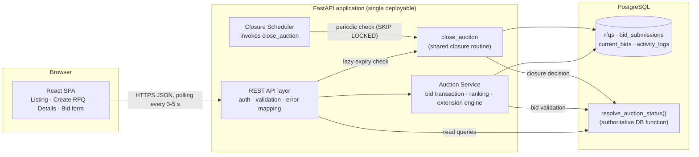
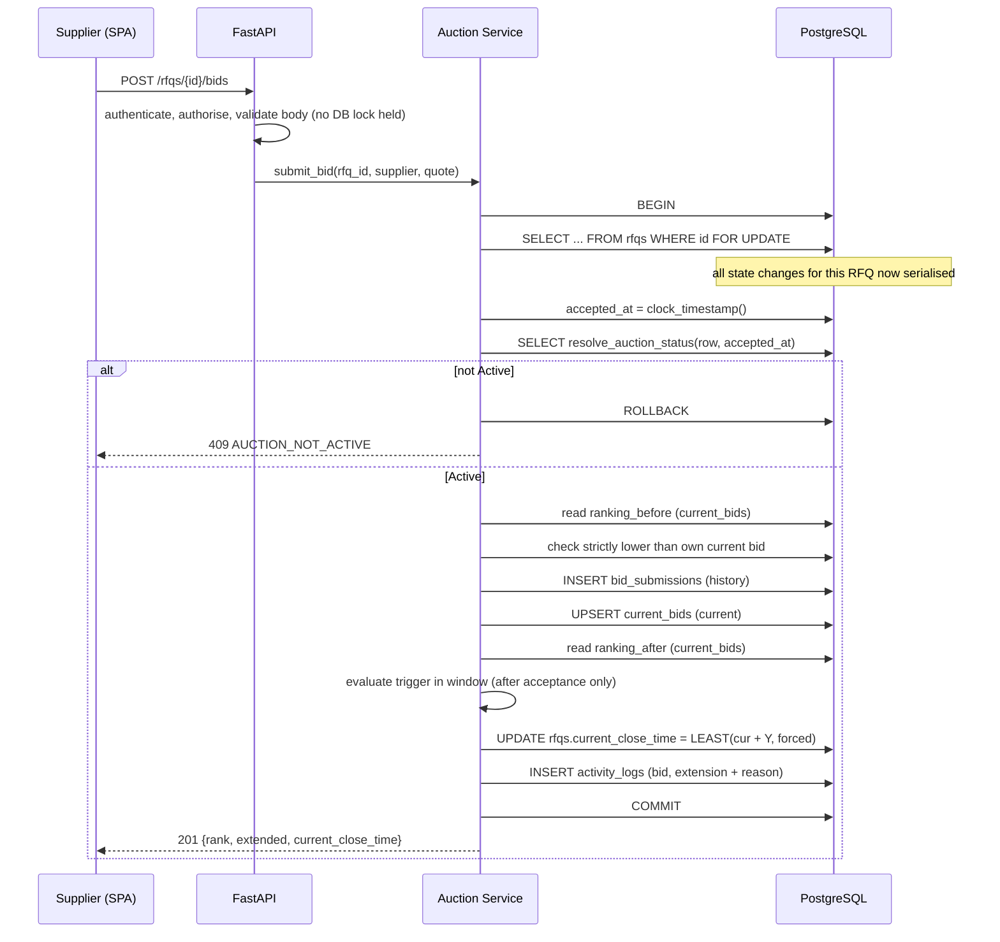
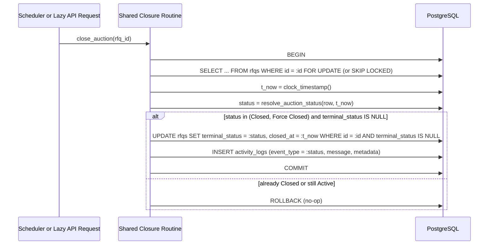
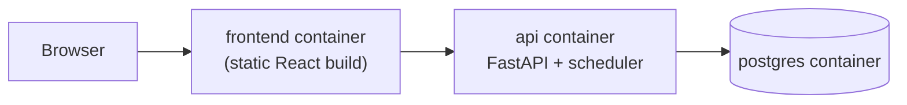

# HLD: British Auction in RFQ System

| | |
|---|---|
| **Status** | Draft v2.0 |
| **Read with** | [`PRD.md`](./PRD.md) (what and why) · [`Technical-Design.md`](./Technical-Design.md) (schema, API, algorithm) |

This is deliberately small: one backend service, one database, one SPA. No message broker, no microservices, no cache. Correctness comes from **PostgreSQL transactions and row locks**, not from infrastructure.

Terminology is defined in `PRD.md` §2 (`current_close_time`, `forced_close_time`, `trigger_window_minutes` = X, `extension_minutes` = Y, `accepted_at`).

---

## 1. Architecture



---

## 2. Components and Responsibilities

| Component | Owns | Does **not** do |
|---|---|---|
| **React SPA** | Pages, forms, countdown display, polling, timezone formatting | Any auction decision. The UI never decides if a bid is valid or if an extension happens; it displays server state. |
| **API layer (FastAPI)** | Authentication (demo header), role checks, request schema validation, error envelope, HTTP status mapping | Business rules |
| **Auction Service** | Orchestrates auction state transitions: the bid transaction (lock → accept → rank → extend → log), RFQ creation, and invokes the shared closure routine | Direct HTTP concerns |
| **Status function (`resolve_auction_status`)** | The **single authoritative database function** implementing Scheduled / Active / Closed / Force Closed (`PRD.md` §4.4). It is the shared implementation called directly by read queries, bid validation, and closure processing. It accepts an explicit database timestamp parameter. | Writes anything |
| **Shared Closure Routine (`close_auction`)** | The **only code path allowed to persist terminal state and write closure audit events**. It acquires `SELECT ... FOR UPDATE` on the RFQ, evaluates the status function using fresh `clock_timestamp()`, updates `terminal_status`/`closed_at`, and writes the closure audit event idempotently. It can be invoked either periodically by the scheduler or lazily by an API request upon detecting an elapsed deadline. | Violate idempotency or run without an RFQ row lock |
| **Closure Scheduler** | Periodically discovers candidate expired RFQs (`terminal_status IS NULL AND current_close_time <= clock_timestamp()`) and calls the shared closure routine using `SKIP LOCKED`. | **Does not enforce the bid deadline.** The bid API checks the deadline itself, so the system is correct even if the scheduler is late, stopped, or runs twice. |
| **PostgreSQL** | Source of truth; row locks serialise state changes per RFQ; CHECK constraints and triggers are the last line of defence for invariants | |

### Scheduler and Closure responsibility (explicit)
| Concern | Who is responsible |
|---|---|
| Rejecting a bid at/after `current_close_time` | **Bid API** (every request, under the row lock) |
| Showing the correct status on reads | **Database status function** (computed dynamically at read time using captured DB time) |
| Persisting `CLOSED`/`FORCE_CLOSED` & writing closure audit entry | **Shared closure routine** (`close_auction`), invoked periodically by the scheduler or lazily by API requests. Both callers use the identical RFQ row lock and idempotency rules. |

If the background scheduler is stopped entirely, the shared closure routine runs lazily whenever an API request notices an expired auction, or at minimum, read queries and bid submissions continue to evaluate status correctly in real-time.

---

## 3. Key Data Flows

### 3.1 Submit a bid (the critical path)



Everything between `BEGIN` and `COMMIT` is **one atomic transaction**. If ranking evaluation, extension calculation, the `current_bids` upsert, or audit log insertion fails for any reason, the entire bid transaction immediately rolls back. No partial state, unranked bid, or incomplete audit entry is ever committed.

### 3.2 Closure (Shared Closure Routine)

The shared closure routine `close_auction` is the only code path permitted to write terminal states. It can be triggered by the background scheduler (running every ~5 s) or lazily by API requests detecting an expired auction.



Both callers use the exact same RFQ row lock, capture fresh `clock_timestamp()`, and adhere to identical idempotency guards (`terminal_status IS NULL`), preventing redundant status writes or duplicate audit events.

### 3.3 Reads (listing and details)
Read endpoints take no row locks. They compute status by passing one explicitly captured database timestamp (`clock_timestamp()` captured for the request) into `resolve_auction_status(..., db_time)`. This ensures that status evaluations never rely on application-server clock drift or transaction-start timestamps (`now()`). The SPA polls every 3 to 5 seconds while the auction is Active, and stops polling once a terminal status is returned.

---

## 4. Data Overview

Full DDL is in `Technical-Design.md` §4.

| Table | Role |
|---|---|
| `users`, `suppliers` | Demo identities; a supplier row is the carrier profile |
| `rfqs` | RFQ + auction configuration + `current_close_time` + `terminal_status` |
| `bid_submissions` | **History**: append-only record of every accepted bid |
| `current_bids` | **Current state**: exactly one row per (RFQ, supplier); the only input to ranking |
| `activity_logs` | Append-only audit trail with reasons |

Both `bid_submissions` (append-only history) and `current_bids` (latest active bid per supplier) are updated synchronously in the exact same database transaction while holding the exclusive `SELECT ... FOR UPDATE` lock on the RFQ row; all ranking queries read strictly from `current_bids`, guaranteeing that ranking can never be distorted by superseded historical bids.

---

## 5. Key Design Decisions

| # | Decision | Why |
|---|---|---|
| D-1 | **Row lock on the RFQ (`SELECT … FOR UPDATE`) for every operation that changes auction state** (bids, closure) | Serialises bids per auction, so "ranking before/after", the extension decision and the close-time update are consistent. One lock per transaction, always the RFQ row first, so no deadlocks. |
| D-2 | **`accepted_at` from the DB clock after the lock is acquired** | `now()` in Postgres is frozen at transaction start, which can be *before* a bid waited for the lock; `clock_timestamp()` read after the lock is the real acceptance moment. One clock, no skew between app servers. |
| D-3 | **Authoritative database status function (`resolve_auction_status`)** | Implemented as a database function accepting an explicit captured DB timestamp; reads, bids, and the shared closure routine evaluate identical logic. Only the terminal state is persisted, and only after the function confirms closure. |
| D-4 | **Dual-table consistency: `bid_submissions` (history) + `current_bids` (current)** | Both tables are updated in the same transaction under the RFQ row lock, and the ranking query reads only `current_bids`. This completely isolates current standings from historical revisions. |
| D-5 | **Invariants enforced in the database as well** (CHECK constraints, append-only triggers, one terminal audit event per RFQ) | A bug in application code cannot silently break the forced-close rule. |
| D-6 | **Polling, not WebSockets** | Simple, adequate for the demo; auction logic doesn't depend on delivery. |
| D-7 | **Scheduler in the API process (APScheduler) or a second container; both are safe** | Closure uses the shared closure routine with `SELECT ... FOR UPDATE SKIP LOCKED` and idempotency guards, so multiple instances don't conflict. |

Explicitly **not** used: Kafka or any queue, microservices, Redis, event sourcing, distributed locks. None are needed to meet the requirements.

---

## 6. Deployment



`docker compose up` brings up all three with migrations and seed data. All timestamps are UTC (`TIMESTAMPTZ`).

---

## 7. Repository Layout

```
/backend
  app/
    main.py
    api/            routers: rfqs, bids, suppliers, health
    services/       auction_service.py   (bid transaction, closure)
                    extension_engine.py  (trigger evaluation, cap calculation; pure functions)
                    ranking.py
    models/         SQLAlchemy models
    schemas/        Pydantic request/response models
    core/           config, db session, error envelope, auth
    scheduler.py
  migrations/       DDL incl. resolve_auction_status(), constraints, triggers
  tests/            unit · integration · concurrency
/frontend
  src/pages/        AuctionList · CreateRfq · AuctionDetails
  src/components/   RankingTable · BidHistory · ActivityLog · Countdown · BidForm · StatusBadge
docker-compose.yml
README.md
```

Keeping `extension_engine.py` as pure functions (no I/O) makes the trigger and cap rules unit-testable without a database.